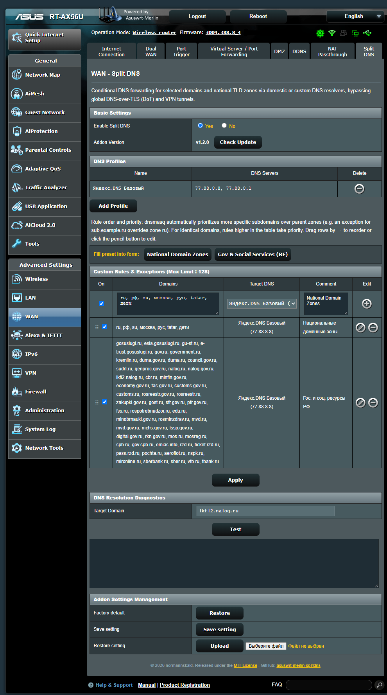

# Asuswrt-Merlin Split DNS (`asuswrt-merlin-splitdns`)

[](LICENSE)
[](https://www.asuswrt-merlin.net/)
[](https://github.com/normannskald/asuswrt-merlin-splitdns/releases)

**[🇷🇺 Русская документация](#-русская-документация) | [🇬🇧 English Documentation](#-english-documentation)**

<p align="center">
  
</p>

---

## 🇷🇺 Русская документация

**Split DNS для Asuswrt-Merlin** — это аддон для роутеров ASUS на прошивке MerlinWRT, предназначенный для гибкой условной маршрутизации DNS-запросов (`dnsmasq conditional forwarding`).

### Проблема, которую решает аддон

При использовании публичных DNS серверов (Cloudflare `1.1.1.1`, Quad9 `9.9.9.9`, Google `8.8.8.8`) или VPN-туннелей многие российские государственные, банковские и региональные сайты (например, `lkfl2.nalog.ru`, `gosuslugi.ru`, `cbr.ru`, `mos.ru`) перестают открываться или отвечают ошибкой `SERVFAIL` / `DNS_PROBE_FINISHED_NXDOMAIN`.

Это происходит потому, что авторитетные NS-серверы ряда российских доменов блокируют или сбрасывают запросы, поступающие с зарубежных IP-адресов публичных DoT-резолверов.

**Split DNS** решает эту проблему на уровне роутера без изменения системных настроек DNS:
- Все мировые сайты продолжают разрешаться через зашифрованный **DNS-over-TLS (Stubby)** или VPN.
- Запросы к выбранным национальным доменным зонам (`.ru`, `.рф`, `.su` и др.), государственным сервисам и вашим собственным правилам направляются напрямую на выбранные вами DNS-серверы (**Яндекс.DNS**, **НСДИ / MSK-IX** или профили провайдера).

---

### Установка в одну команду (SSH)

Подключитесь к роутеру по SSH под учётной записью администратора и выполните:

```sh
curl -fsSL https://raw.githubusercontent.com/normannskald/asuswrt-merlin-splitdns/main/install.sh | sh
```

> **Требования**: Прошивка Asuswrt-Merlin с включённым разделом JFFS (*Администрирование → Система → Enable JFFS custom scripts and configs = Yes*).

После установки в боковом меню роутера в разделе **Интернет (WAN)** появится вкладка **Split DNS**, а скрипт выведет прямой адрес страницы (например, `http://192.168.50.1/user3.asp`).

---

### Безопасное удаление аддона без остатка

Если вы решите удалить Split DNS, аддон удаляется полностью и бесследно в автоматическом режиме:

#### Способ 1. Удаление одной командой (SSH)
```sh
curl -fsSL https://raw.githubusercontent.com/normannskald/asuswrt-merlin-splitdns/main/install.sh | sh -s -- uninstall
```

#### Способ 2. Через интерактивное меню
Запустите установщик на роутере:
```sh
sh /jffs/addons/splitdns/install.sh
```
и выберите пункт `5) Uninstall Addon`.

#### Способ 3. Прямая CLI-команда
```sh
/jffs/addons/splitdns/splitdns.sh uninstall
```

**Что происходит при удалении:**
1. Размонтируется веб-страница и освобождается выделенный слот `userX.asp`.
2. Вкладка `Split DNS` аккуратно удаляется из файла меню прошивки (`menuTree.js`), сохраняя вкладки всех соседних аддонов (например, AmneziaWG).
3. Удаляется файл сгенерированных директив `dnsmasq_splitdns.conf` и его подключение из `/jffs/configs/dnsmasq.conf.add`.
4. Удаляются интеграционные хуки из `/jffs/scripts/dnsmasq.postconf`, `/jffs/scripts/services-start` и `/jffs/scripts/service-event`.
5. Очищаются транзитные параметры из `/jffs/addons/custom_settings.txt`.
6. Служба `dnsmasq` проверяется и безопасно перезапускается.
7. Полностью удаляется каталог `/jffs/addons/splitdns/` и ярлык `/opt/bin/splitdns`.
8. Настройки сети, VPN, DoT и сторонние аддоны остаются нетронутыми.

---

### Руководство по использованию

Веб-интерфейс Split DNS встраивается в прошивку роутера, оформлен по официальным гайдлайнам Asuswrt и включает следующие возможности:

#### 1. Управление профилями DNS («Профили DNS»)
В отдельном блоке **Профили DNS** настраивается список резолверов для правил:
- **Таблица профилей**: отображает название каждого профиля, назначенные DNS-серверы (IPv4, IPv6 с поддержкой нестандартных портов вида `#5353`) и кнопку удаления.
- **Добавление профиля через модальное окно**: нажатие на кнопку **Добавить профиль** открывает диалоговое окно.
- **Быстрые пресеты в один клик**:
  - *Яндекс.DNS Базовый* (`77.88.8.8`, `77.88.8.1`)
  - *Яндекс.DNS Безопасный* (`77.88.8.88`, `77.88.8.2`)
  - *Яндекс.DNS Семейный* (`77.88.8.7`, `77.88.8.3`)
  - *НСДИ / MSK-IX* (`195.208.4.1`, `195.208.5.1`)
  - *Cloudflare DNS* (`1.1.1.1`, `1.0.0.1`)
  - *Google Public DNS* (`8.8.8.8`, `8.8.4.4`)
  - *Quad9 DNS* (`9.9.9.9`, `149.112.112.112`)
  - *AdGuard DNS* (`94.140.14.14`, `94.140.15.15`)
  - *Системный DNS (WAN)*
- **Автогенерация названия**: если поле названия оставить пустым, оно автоматически сформируется из введённых адресов DNS-серверов.

#### 2. Пользовательские правила и исключения
Правила маршрутизации задаются в таблице **Пользовательские правила и исключения**:
- **Валидация доменов**: поддерживается разделение доменов любыми символами — переносами строк, запятыми, точками с запятой, табуляцией и пробелами. Кириллические домены IDN автоматически конвертируются в Punycode.
- **Быстрые пресеты доменов**:
  - `Национальные доменные зоны`: заполняет поле списком `ru, рф, su, москва, рус, tatar, дети`.
  - `Гос. и соц. ресурсы РФ`: заполняет поле списком из 54 ключевых доменов (Госуслуги, ФНС, Банк России, суды, ведомства, банки, транспорт).
- **Выбор целевого DNS для каждого правила**:
  - **Системный DNS роутера (`127.0.1.1`)**: исключение конкретного домена из-под общего перенаправления обратно в системный зашифрованный DoT/WAN роутера.
  - **Пользовательские профили DNS**: направление запросов на любой профиль, созданный в блоке «Профили DNS».

#### 3. Приоритет правил, редактирование и Drag-and-Drop
- **Изменение приоритета перетаскиванием (Drag-and-Drop)**: зажмите значок `⋮⋮` слева от правила и перетащите строку выше или ниже. При совпадении доменов верхнее правило имеет приоритет над нижним.
- **Естественный приоритет поддоменов в dnsmasq**: более специфичные поддомены всегда имеют естественный приоритет над родительской зоной (например, `sub.example.ru` главнее правила для всей зоны `ru`).
- **Редактирование записей**: нажатие на круглую иконку с карандашом возвращает параметры правила в строку ввода для быстрой правки.
- **Временное отключение**: чекбокс в колонке «Вкл» позволяет выключить правило без его удаления из списка.

#### 4. Диагностика резолвинга
- Введите домен (по умолчанию подставлен `lkfl2.nalog.ru`) и нажмите **Проверить**.
- Роутер выводит статус разрешения, использованный DNS-сервер, список полученных IP-адресов и точное время отклика в миллисекундах.

#### 5. Управление настройками аддона
- **Сохранение настроек**: скачивает все текущие параметры, профили DNS и таблицу правил в JSON-файл резервной копии.
- **Восстановление настроек**: загружает и валидирует конфигурацию из ранее сохранённого JSON-файла.
- **Заводские настройки**: безопасно сбрасывает настройки и правила Split DNS, не затрагивая конфигурацию роутера или соседних аддонов.

#### 6. Обновление аддона
- Кнопка **Проверить обновление** сравнивает текущую установленную версию с последней версией в репозитории GitHub.
- При наличии свежего релиза появляется кнопка **Обновить**, позволяющая обновить аддон в один клик с сохранением всех существующих настроек и правил.

---

### Управление через SSH (CLI)

| Команда | Описание |
| :--- | :--- |
| `/jffs/addons/splitdns/splitdns.sh status` | Показать текущий статус службы, профили, активный слот `userX.asp` и пути к файлам |
| `/jffs/addons/splitdns/splitdns.sh start` | Смонтировать веб-интерфейс, сгенерировать правила и запустить Split DNS |
| `/jffs/addons/splitdns/splitdns.sh stop` | Отключить правила Split DNS от `dnsmasq` и безопасно перезапустить `dnsmasq` |
| `/jffs/addons/splitdns/splitdns.sh restart` | Полный перезапуск службы Split DNS |
| `/jffs/addons/splitdns/splitdns.sh apply` | Применить текущие настройки и перегенерировать правила `dnsmasq` |
| `/jffs/addons/splitdns/splitdns.sh reset` | Выполнить сброс настроек Split DNS к начальным значениям |
| `/jffs/addons/splitdns/splitdns.sh test_domain lkfl2.nalog.ru` | Выполнить диагностический DNS-запрос и вывести результат в формате JSON |
| `/jffs/addons/splitdns/splitdns.sh check_update` | Проверить наличие новой версии на GitHub (выводит JSON) |
| `/jffs/addons/splitdns/splitdns.sh update` | Скачать и установить последнюю версию с GitHub с сохранением настроек |
| `/jffs/addons/splitdns/splitdns.sh uninstall` | Полностью и без остатка удалить аддон с роутера |

---

### История изменений (Changelog)

История версий и подробный список изменений доступны в файле [CHANGELOG.md](CHANGELOG.md) и в разделе [Релизы GitHub](https://github.com/normannskald/asuswrt-merlin-splitdns/releases).

---

## 🇬🇧 English Documentation

**Split DNS for Asuswrt-Merlin** is an addon for ASUS routers running MerlinWRT firmware, designed for flexible conditional DNS routing (`dnsmasq conditional forwarding`).

### Problem Statement

When using public DNS servers (Cloudflare `1.1.1.1`, Quad9 `9.9.9.9`, Google `8.8.8.8`) or VPN tunnels on your router, many Russian national, government, banking, and regional domains (such as `lkfl2.nalog.ru`, `gosuslugi.ru`, `cbr.ru`, `mos.ru`) fail to resolve (`SERVFAIL` / timeout) because their authoritative nameservers drop queries originating from foreign resolver IP addresses.

**Split DNS** solves this cleanly at the router level without modifying system DNS settings:
- Global traffic continues resolving through your encrypted **DNS-over-TLS (Stubby)** or VPN configuration.
- National TLD zones (`.ru`, `.рф`, `.su`, etc.), government services, and custom domain rules are selectively routed to your chosen DNS resolvers (**Yandex.DNS**, **NSDI / MSK-IX**, or ISP WAN profiles).

---

### One-Line Installation (SSH)

Connect to your router via SSH with administrator privileges and run:

```sh
curl -fsSL https://raw.githubusercontent.com/normannskald/asuswrt-merlin-splitdns/main/install.sh | sh
```

> **Requirements**: Asuswrt-Merlin firmware with JFFS enabled (*Administration → System → Enable JFFS custom scripts and configs = Yes*).

Once installed, the **Split DNS** tab will appear under the **WAN** menu, and the installer will display the direct page URL (e.g., `http://192.168.50.1/user3.asp`).

---

### Clean & Safe Uninstallation

If you ever wish to remove Split DNS, it uninstalls cleanly and leaves zero traces:

#### Option 1. One-Line SSH Command
```sh
curl -fsSL https://raw.githubusercontent.com/normannskald/asuswrt-merlin-splitdns/main/install.sh | sh -s -- uninstall
```

#### Option 2. Interactive Installer Menu
Run the installer script on the router:
```sh
sh /jffs/addons/splitdns/install.sh
```
and select option `5) Uninstall Addon`.

#### Option 3. Direct CLI Command
```sh
/jffs/addons/splitdns/splitdns.sh uninstall
```

**Uninstallation Process:**
1. Unmounts the Web UI page and frees the allocated `userX.asp` slot.
2. Removes the `Split DNS` tab from the firmware navigation menu (`menuTree.js`), leaving adjacent addons (such as AmneziaWG) untouched.
3. Removes `dnsmasq_splitdns.conf` and cleans its include line from `/jffs/configs/dnsmasq.conf.add`.
4. Removes startup and event hooks from `/jffs/scripts/dnsmasq.postconf`, `/jffs/scripts/services-start`, and `/jffs/scripts/service-event`.
5. Cleans up transient parameters from `/jffs/addons/custom_settings.txt`.
6. Safely validates and restarts `dnsmasq`.
7. Removes `/jffs/addons/splitdns/` and the `/opt/bin/splitdns` symlink.
8. Network, WAN, VPN, and router settings remain completely intact.

---

### Usage Guide

The Split DNS Web UI integrates into the router firmware and provides the following features:

#### 1. DNS Profiles Management ("DNS Profiles")
Configure upstream DNS resolvers in the dedicated **DNS Profiles** section:
- **Profiles Table**: lists each profile name, configured DNS server addresses (IPv4, IPv6 with optional `#port` notation), and delete action.
- **Add Profile Modal**: clicking **Add Profile** opens a popup dialog.
- **One-Click Popular Presets**:
  - *Yandex.DNS Basic* (`77.88.8.8`, `77.88.8.1`)
  - *Yandex.DNS Safe* (`77.88.8.88`, `77.88.8.2`)
  - *Yandex.DNS Family* (`77.88.8.7`, `77.88.8.3`)
  - *NSDI / MSK-IX* (`195.208.4.1`, `195.208.5.1`)
  - *Cloudflare DNS* (`1.1.1.1`, `1.0.0.1`)
  - *Google Public DNS* (`8.8.8.8`, `8.8.4.4`)
  - *Quad9 DNS* (`9.9.9.9`, `149.112.112.112`)
  - *AdGuard DNS* (`94.140.14.14`, `94.140.15.15`)
  - *System WAN DNS*
- **Auto-Generated Name**: leaving the profile name blank automatically formats the title from the entered DNS IP addresses.

#### 2. Custom Rules & Exceptions
Routing rules are managed in the **Custom Rules & Exceptions** table:
- **Domain Validation**: supports delimiters across newlines, commas, semicolons, tabs, and spaces. Cyrillic IDN domains are automatically converted to Punycode.
- **Quick-Fill Domain Presets**:
  - `National Domain Zones`: fills the input field with `ru, рф, su, москва, рус, tatar, дети`.
  - `Gov & Social Services (RF)`: fills the input field with a curated list of 54 essential domains.
- **Target DNS Selection**:
  - **Router System DNS (`127.0.1.1`)**: routes queries back to the router's native encrypted DoT/WAN upstream as an explicit exception from Split DNS.
  - **Custom DNS Profiles**: routes domain queries to any profile defined in the DNS Profiles block.

#### 3. Rule Priority, In-Place Editing & Drag-and-Drop
- **Drag-and-Drop Reordering**: click and drag the `⋮⋮` handle on the left to move a row up or down. Rules located higher in the table take priority for identical domains.
- **Subdomain Priority in dnsmasq**: more specific subdomains always take natural precedence over parent zones (e.g., a rule for `sub.example.ru` overrides the parent `.ru` zone rule).
- **In-Place Editing**: click the round pencil icon (`.edit_btn`) on any rule to load its values back into the input row for quick edits.
- **Quick Enable/Disable**: use the checkbox in the "On" column to temporarily toggle a rule without deleting it.

#### 4. Resolution Diagnostics
- Enter any domain (default placeholder: `lkfl2.nalog.ru`) and click **Test**.
- The router displays resolution status, resolver IP, resolved addresses, and query latency.

#### 5. Backup, Restore & Reset
- **Save setting**: downloads a complete JSON backup of all Split DNS settings, profiles, and custom rules.
- **Restore setting**: uploads and validates a previously exported JSON backup file.
- **Factory default**: cleanly resets Split DNS configuration and rules without affecting the rest of the router or other addons.

#### 6. Addon Updates
- **Check Update**: checks the remote GitHub repository for newer releases.
- If a new version is available, the **Update** button appears, allowing you to update in one click while preserving your existing configuration.

---

### SSH CLI Management

| Command | Description |
| :--- | :--- |
| `/jffs/addons/splitdns/splitdns.sh status` | Show service status, profiles, dynamic slot `userX.asp`, and file paths |
| `/jffs/addons/splitdns/splitdns.sh start` | Mount Web UI, generate dnsmasq configuration, and start service |
| `/jffs/addons/splitdns/splitdns.sh stop` | Detach rules from `dnsmasq` and safely restart `dnsmasq` |
| `/jffs/addons/splitdns/splitdns.sh restart` | Restart Split DNS service and reload dnsmasq |
| `/jffs/addons/splitdns/splitdns.sh apply` | Apply active configuration and regenerate dnsmasq rules |
| `/jffs/addons/splitdns/splitdns.sh reset` | Perform a surgical reset of Split DNS settings to defaults |
| `/jffs/addons/splitdns/splitdns.sh test_domain lkfl2.nalog.ru` | Perform a diagnostic DNS query and output JSON |
| `/jffs/addons/splitdns/splitdns.sh check_update` | Check for newer releases on GitHub (outputs JSON) |
| `/jffs/addons/splitdns/splitdns.sh update` | Download and install latest release from GitHub preserving settings |
| `/jffs/addons/splitdns/splitdns.sh uninstall` | Completely uninstall Split DNS and remove all traces from router |

---

### Releases & Changelog

Version history and detailed changelog are available in [CHANGELOG.md](CHANGELOG.md) and on the [GitHub Releases](https://github.com/normannskald/asuswrt-merlin-splitdns/releases) page.

---

### File Architecture on Router

```text
/jffs/addons/splitdns/
├── splitdns.sh             # Backend controller & CLI manager
├── splitdns_page.asp       # Bilingual ROG/Asuswrt Web UI source
├── install.sh              # Local copy of installer & interactive SSH menu
├── splitdns.conf           # Persistent key-value configuration
├── profiles.json           # Persistent DNS upstream profiles (JSON)
├── rules.json              # Persistent custom rules & exceptions (JSON)
└── dnsmasq_splitdns.conf   # Generated dnsmasq server=/domain/ip directives
```

---

### License

Released under the [MIT License](LICENSE). Copyright (c) 2026 [normannskald](https://github.com/normannskald).
